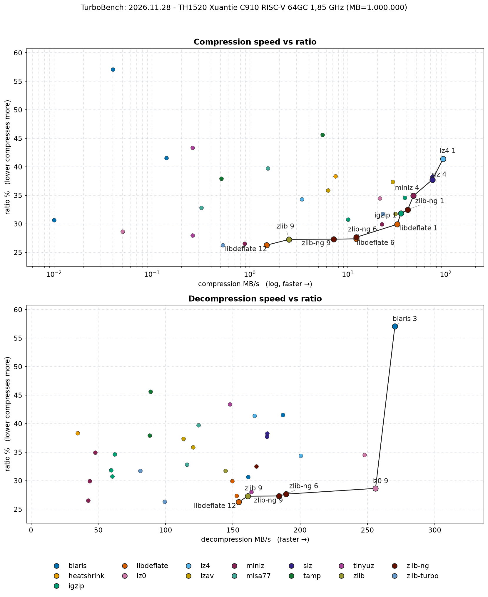
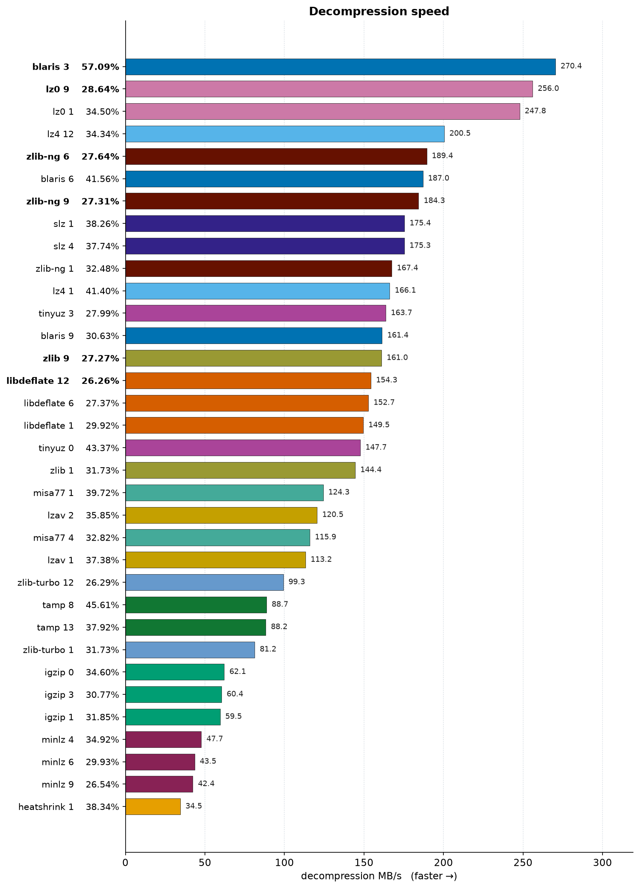

<!-- generated by scripts/bench_views.py -->

#### TurboBench: 2026.11.28 - TH1520 Xuantie C910 RISC-V 64GC 1,85 GHz (MB=1.000.000)
Pico : 2 KB Ram / Tiny : 2-8 KB Ram / Small: 8-32 KB Ram / Medium : 32-256 KB Ram | Large: > 256 KB

|[C Size](micro.md)|[ratio%](micro_ratio.md)|[C MB/s](micro_CMBs.md)|[D MB/s](micro_DMBs.md)|[Rank](micro_Rank.md)|**C Mem**|[C Stack](micro_CStack.md)|[D Mem](micro_DMem.md)|[D Stack](micro_DStack.md)|[Name](micro_Name.md)|[File](micro_File.md)|[D Cat](micro_DCat.md)|
|---:|---:|---:|---:|---:|---:|---:|---:|---:|:---|:---|:---|
|94656|26.54%|0.88|42.37|26|0|2912|0|1144|minlz 9|data|Small|
|106734|29.93%|22.28|43.47|19|0|1792|0|1200|minlz 6|data|Small|
|123408|34.60%|38.02|62.13|20|0|312|0|8160|igzip 0|data|Small|
|124544|34.92%|$\color{green}{\textbf{46.69}}$|47.70|24|0|3208|0|1240|$\color{green}{\textbf{minlz 4}}$|data|Small|
|134618|37.74%|$\color{green}{\textbf{72.82}}$|175.35|4🥈|0|65808|8328|232|$\color{green}{\textbf{slz 4}}$|data|Small|
|135252|37.92%|0.51|88.22|31|0|424|0|264|tamp 13|data|Tiny|
|136457|38.26%|72.36|175.43|5🥉|0|65808|8328|232|slz 1|data|Small|
|162679|45.61%|5.52|88.70|32|0|424|0|264|tamp 8|data|Tiny|
|356654|100.00%|$\color{green}{\textbf{8105.77}}$|$\color{green}{\textbf{8105.77}}$|35|0|80|0|80|$\color{green}{\textbf{memcpy}}$|data||
|147659|41.40%|$\color{green}{\textbf{93.68}}$|166.12|8|16768|600|524664|400|$\color{green}{\textbf{lz4 1}}$|data|Large|
|136739|38.34%|7.46|34.52|29|20640|0|10632|0|heatshrink 1|data|Tiny|
|123057|34.50%|21.15|247.85|6|198384|18144|0|0|lz0 1|data|Pico|
|106718|29.92%|$\color{green}{\textbf{31.93}}$|149.54|12|202760|1968|19736|928|$\color{green}{\textbf{libdeflate 1}}$|data|Medium|
|97248|27.27%|$\color{green}{\textbf{2.51}}$|$\color{green}{\textbf{161.02}}$|7|268152|736|8328|624|$\color{green}{\textbf{zlib 9}}$|data|Small|
|113182|31.73%|30.62|144.45|14|268152|704|8328|624|zlib 1|data|Small|
|113182|31.73%|22.66|81.22|17|268216|0|8328|752|zlib-turbo 1|data|Small|
|113592|31.85%|$\color{green}{\textbf{34.71}}$|59.53|18|282632|14960|0|8160|$\color{green}{\textbf{igzip 1}}$|data|Small|
|122473|34.34%|3.39|200.48|13|328128|1616|524664|400|lz4 12|data|Large|
|97396|27.31%|$\color{green}{\textbf{7.15}}$|$\color{green}{\textbf{184.32}}$|2🏆|333320|1696|46152|752|$\color{green}{\textbf{zlib-ng 9}}$|data|Medium|
|98587|27.64%|$\color{green}{\textbf{12.17}}$|$\color{green}{\textbf{189.41}}$|1👑|333320|1696|46152|752|$\color{green}{\textbf{zlib-ng 6}}$|data|Medium|
|115842|32.48%|$\color{green}{\textbf{40.70}}$|167.44|3🥇|333320|1664|46152|752|$\color{green}{\textbf{zlib-ng 1}}$|data|Medium|
|109736|30.77%|10.06|60.41|22|348168|14960|0|8160|igzip 3|data|Small|
|127852|35.85%|6.28|120.49|25|524296|0|0|192|lzav 2|data|Small|
|133326|37.38%|28.63|113.19|23|524296|800|0|192|lzav 1|data|Small|
|97601|27.37%|$\color{green}{\textbf{12.15}}$|152.74|10|864904|2064|19736|928|$\color{green}{\textbf{libdeflate 6}}$|data|Medium|
|99838|27.99%|0.26|163.68|15|1410704|44272|0|16|tinyuz 3|data|Tiny|
|154694|43.37%|0.26|147.68|33|1410704|44272|0|16|tinyuz 0|data|Tiny|
|148240|41.56%|0.14|187.02|30|2002144|472|0|232|blaris 6|data|Pico|
|203597|57.09%|0.04|$\color{green}{\textbf{270.40}}$|34|2002144|704|0|232|$\color{green}{\textbf{blaris 3}}$|data|Pico|
|141655|39.72%|1.52|124.31|28|2162704|552|0|336|misa77 1|data|Small|
|109242|30.63%|0.01|161.38|21|2539536|800|0|208|blaris 9|data|Pico|
|102129|28.64%|0.05|$\color{green}{\textbf{256.03}}$|9|3121520|19600|0|0|$\color{green}{\textbf{lz0 9}}$|data|Pico|
|117064|32.82%|0.32|115.91|27|4060264|2872|0|240|misa77 4|data|Small|
|93668|26.26%|$\color{green}{\textbf{1.48}}$|$\color{green}{\textbf{154.33}}$|11|9012808|2272|19736|928|$\color{green}{\textbf{libdeflate 12}}$|data|Medium|
|93763|26.29%|0.53|99.26|16|24338448|0|8328|752|zlib-turbo 12|data|Small|

Each point is one codec level. Color is the codec family. The line is the Pareto front (nothing else is both smaller and faster) and only that front is labeled. Every codec is named on the bar chart. memcpy is omitted so the scale stays readable.

Fastest decompression at the top. The ratio is next to the name. Bold names are on the decompression Pareto front. memcpy is omitted so the scale stays readable.
